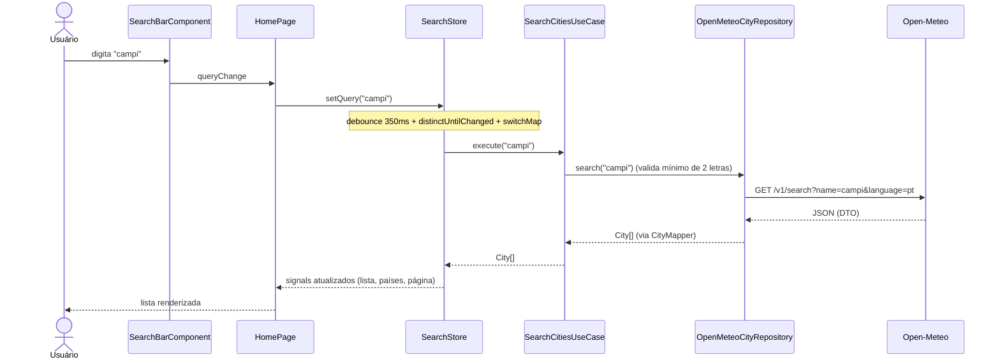

# 🌤️ angular-weather-dashboard

Dashboard de clima feito com **Angular 21**, **TypeScript**, **RxJS** e **Signals**, organizado em **Clean Architecture** com orientação a objetos.

> Projeto 1 do roadmap **Frontend → Angular/Java Fullstack → Cloud**: _Angular → API externa, sem Spring ainda_.
> Os dados vêm da [Open-Meteo](https://open-meteo.com/), que é gratuita e **não exige chave de API**.

---

## Sumário

1. [Funcionalidades](#1-funcionalidades)
2. [Stack](#2-stack)
3. [Pré-requisitos](#3-pré-requisitos)
4. [Como rodar na sua máquina](#4-como-rodar-na-sua-máquina)
5. [Scripts disponíveis](#5-scripts-disponíveis)
6. [Arquitetura](#6-arquitetura)
7. [Estrutura de pastas e responsabilidades](#7-estrutura-de-pastas-e-responsabilidades)
8. [Fluxo do projeto (passo a passo)](#8-fluxo-do-projeto-passo-a-passo)
9. [Orientação a objetos no projeto](#9-orientação-a-objetos-no-projeto)
10. [Decisões técnicas](#10-decisões-técnicas)
11. [Como estender o projeto](#11-como-estender-o-projeto)
12. [Testes](#12-testes)
13. [Problemas comuns](#13-problemas-comuns)
14. [Próximos passos](#14-próximos-passos)
15. [Créditos e atribuição](#15-créditos-e-atribuição)

---

## 1. Funcionalidades

- **Pesquisa de cidades** com _debounce_ (só consulta a API depois que você para de digitar).
- **Filtro por país** sobre os resultados da busca.
- **Paginação** dos resultados.
- 🌡️ **Dashboard da cidade**: clima atual (temperatura, sensação, umidade, vento) e **previsão de 7 dias**.
- **Favoritos** persistidos no `localStorage`.
- **Dark mode** (respeita o tema do sistema na primeira visita e lembra a sua escolha).
- °C / °F alternável.
- Estados de **loading** e **tratamento de erro** com botão "Tentar novamente".
- **Responsivo** e com foco em acessibilidade (labels, `aria-*`, foco visível, `prefers-reduced-motion`).
- 🔗 URLs compartilháveis: `/forecast/:id?lat=...&lon=...&name=...` sobrevivem ao F5.

## 2. Stack

| Camada | Tecnologia |
| --- | --- |
| Framework | Angular 21 (standalone components, `@if`/`@for`, `inject()`, zoneless) |
| Linguagem | TypeScript (modo `strict`) |
| Estado | Signals (estado) + RxJS (fluxos assíncronos) |
| HTTP | `HttpClient` com `withFetch()` |
| Estilo | SCSS + CSS variables (tema claro/escuro) |
| Testes | Vitest (runner padrão do Angular 21) + `HttpTestingController` |
| API | [Open-Meteo](https://open-meteo.com/) (Geocoding + Forecast) |

## 3. Pré-requisitos

| Ferramenta | Versão | Para quê |
| --- | --- | --- |
| **Node.js** | `^20.19.0`, `^22.12.0` ou `^24.0.0` (recomendado: **22 LTS**) | Rodar o Angular CLI |
| **npm** | 10 ou superior (já vem com o Node) | Instalar dependências |
| **Git** | qualquer versão recente | Clonar/versionar |

Confira no terminal:

```bash
node -v   # v22.x.x
npm -v    # 10.x.x
git --version
```

> Dica: se usa [nvm](https://github.com/nvm-sh/nvm), basta rodar `nvm install && nvm use` na pasta do projeto — o arquivo `.nvmrc` já aponta para a versão 22.

## 4. Como rodar na sua máquina

```bash
# 1. Clone o repositório (ou descompacte o .zip e entre na pasta)
git clone https://github.com/<seu-usuario>/angular-weather-dashboard.git
cd angular-weather-dashboard

# 2. Instale as dependências (cria a pasta node_modules e o package-lock.json)
npm install

# 3. Suba o servidor de desenvolvimento
npm start
```

Abra **http://localhost:4200** no navegador. O app recarrega sozinho quando você salva um arquivo.

Não há `.env`, chave de API ou banco de dados para configurar.

> Depois do primeiro `npm install`, faça commit do `package-lock.json`: ele garante que todo mundo instale exatamente as mesmas versões.

## 5. Scripts disponíveis

| Comando | O que faz |
| --- | --- |
| `npm start` | Servidor de desenvolvimento em `http://localhost:4200` |
| `npm run build` | Build de produção em `dist/angular-weather-dashboard/browser` |
| `npm run watch` | Build contínuo em modo desenvolvimento |
| `npm test` | Testes unitários em modo _watch_ |
| `npm run test:ci` | Testes unitários uma única vez (ideal para CI) |

Para testar o build de produção localmente:

```bash
npm run build
npx serve dist/angular-weather-dashboard/browser
```

## 6. Arquitetura

O projeto segue **Clean Architecture**: o código é dividido em camadas e **as dependências só apontam para dentro** — as regras de negócio não sabem que Angular, HTTP ou `localStorage` existem.

```
┌──────────────────────────────────────────────────────────────┐
│  presentation   (Angular: páginas, componentes, stores)      │
│  ┌────────────────────────────────────────────────────────┐  │
│  │  infrastructure   (Open-Meteo, localStorage, mappers)  │  │
│  │  ┌──────────────────────────────────────────────────┐  │  │
│  │  │  application   (casos de uso)                    │  │  │
│  │  │  ┌────────────────────────────────────────────┐  │  │  │
│  │  │  │  domain  (entidades, VOs, portas, erros)   │  │  │  │
│  │  │  └────────────────────────────────────────────┘  │  │  │
│  │  └──────────────────────────────────────────────────┘  │  │
│  └────────────────────────────────────────────────────────┘  │
└──────────────────────────────────────────────────────────────┘

        Regra de dependência:  presentation ─► application ─► domain
                               infrastructure ─────────────► domain
                               (domain não importa nada das outras camadas)
```

| Camada | Responsabilidade | Pode importar de |
| --- | --- | --- |
| `domain` | Regras e conceitos do negócio: entidades, _value objects_, erros e **portas** (contratos abstratos de repositórios) | nada (só `rxjs` para tipar `Observable`) |
| `application` | **Casos de uso**: cada ação que o usuário pode fazer (buscar cidade, favoritar, ver previsão…) | `domain` |
| `infrastructure` | **Adaptadores**: implementam as portas falando com Open-Meteo e `localStorage`; traduzem DTOs ↔ domínio | `domain` |
| `presentation` | Telas, componentes, pipes e _stores_ (estado reativo da UI) | `application`, `domain`, `shared` |
| `shared` | Utilitários genéricos sem regra de negócio (ex.: paginação) | nada |

### Inversão de dependência na prática

```ts
// domain/repositories/city.repository.ts  → a PORTA (abstração)
export abstract class CityRepository {
  abstract search(query: string): Observable<City[]>;
}

// infrastructure/open-meteo/open-meteo-city.repository.ts → o ADAPTADOR
@Injectable()
export class OpenMeteoCityRepository extends CityRepository { /* HttpClient aqui */ }

// infrastructure/infrastructure.providers.ts → a LIGAÇÃO (único lugar que conhece os dois)
{ provide: CityRepository, useClass: OpenMeteoCityRepository }
```

O caso de uso pede um `CityRepository` e **nunca sabe** que por trás existe a Open-Meteo. Nos testes, basta trocar por uma classe falsa.

## 7. Estrutura de pastas e responsabilidades

```
angular-weather-dashboard/
├── README.md
├── package.json · angular.json · tsconfig*.json     # configuração do projeto/Angular CLI
├── public/                                          # arquivos estáticos (favicon)
└── src/
    ├── main.ts                                      # ponto de entrada: sobe o AppComponent
    ├── index.html · styles.scss                     # HTML base e estilos globais (tokens de tema)
    ├── testing/city.factory.ts                      # builder de City para os testes
    └── app/
        ├── app.component.ts                         # "casca" do app: header + router-outlet + footer
        ├── app.config.ts                            # providers globais (router, http, infraestrutura)
        ├── app.routes.ts                            # rotas (lazy loading das páginas)
        │
        ├── domain/                                  # NÚCLEO — sem Angular
        │   ├── entities/
        │   │   ├── city.ts                          # cidade (identidade = id)
        │   │   ├── current-weather.ts               # clima no momento
        │   │   ├── daily-forecast.ts                # previsão de um dia
        │   │   ├── weather-report.ts                # agregado: atual + dias
        │   │   └── user-preferences.ts              # tema + unidade (imutável)
        │   ├── value-objects/
        │   │   ├── coordinates.ts                   # lat/lon sempre válidos
        │   │   ├── temperature.ts                   # °C ↔ °F
        │   │   ├── weather-condition.ts             # código WMO → categoria + descrição
        │   │   └── theme-mode.ts                    # 'light' | 'dark'
        │   ├── collections/city-collection.ts       # lista de cidades + países + filtro
        │   ├── errors/                              # DomainError e erros específicos
        │   └── repositories/                        # PORTAS (classes abstratas)
        │
        ├── application/use-cases/                   # um arquivo = uma ação do usuário
        │   ├── search-cities.use-case.ts
        │   ├── get-weather-report.use-case.ts
        │   ├── list-favorites.use-case.ts
        │   ├── toggle-favorite.use-case.ts
        │   ├── get-preferences.use-case.ts
        │   └── save-preferences.use-case.ts
        │
        ├── infrastructure/                          # mundo externo
        │   ├── infrastructure.providers.ts          # liga porta → adaptador (composition root)
        │   ├── config/api.config.ts                 # URLs e parâmetros da API (InjectionToken)
        │   ├── open-meteo/
        │   │   ├── dto/                             # formato EXATO das respostas da API
        │   │   ├── mappers/                         # DTO → entidades do domínio
        │   │   ├── http-error.mapper.ts             # HttpErrorResponse → DomainError
        │   │   ├── open-meteo-city.repository.ts    # implementa CityRepository
        │   │   └── open-meteo-weather.repository.ts # implementa WeatherRepository
        │   └── storage/
        │       ├── safe-local-storage.ts            # localStorage que nunca lança exceção
        │       ├── stored-city.mapper.ts            # City ↔ JSON salvo
        │       ├── local-storage-favorites.repository.ts
        │       └── local-storage-user-preferences.repository.ts
        │
        ├── presentation/                            # Angular / UI
        │   ├── pages/                               # componentes "container" (ligam stores à tela)
        │   │   ├── home/                            # busca + filtro + lista + paginação + favoritos
        │   │   ├── forecast/                        # detalhe: clima atual + 7 dias
        │   │   └── not-found/
        │   ├── components/                          # componentes "burros" (só inputs/outputs)
        │   ├── layout/header/                       # cabeçalho: tema e unidade
        │   ├── state/                               # stores com Signals (estado da UI)
        │   ├── mappers/city-route.mapper.ts         # City ↔ parâmetros de URL
        │   └── pipes/                               # temperature, weatherIcon, dateLabel
        │
        └── shared/pagination/pagination.ts          # paginação genérica em memória
```

**Regra para achar onde mexer:**

- _"Mudou uma regra do negócio"_ → `domain`
- _"Nova ação do usuário"_ → `application` (+ tela em `presentation`)
- _"Trocar de API / de storage"_ → `infrastructure`
- _"Mudar visual ou comportamento da tela"_ → `presentation`

## 8. Fluxo do projeto (passo a passo)

### 8.1 Inicialização

1. `main.ts` chama `bootstrapApplication(AppComponent, appConfig)`.
2. `app.config.ts` registra router, `HttpClient` e `provideInfrastructure()`, que **liga cada porta do domínio ao adaptador concreto**.
3. `PreferencesStore` lê as preferências salvas (ou o tema do sistema) e aplica `data-theme` no `<html>`.

### 8.2 Buscar uma cidade



- `switchMap` **cancela** a requisição anterior se você continuar digitando.
- Erros viram `DomainError` com mensagem amigável e a tela mostra o botão **Tentar novamente**.
- Trocar o filtro de país ou a página só recalcula _computed signals_ — não chama a API de novo.

### 8.3 Ver a previsão

1. Clicar numa cidade navega para `/forecast/:id?lat=…&lon=…&name=…` (`CityRouteMapper` monta a URL).
2. `ForecastPage` lê a URL, reconstrói a `City` e chama `ForecastStore.load(city)`.
3. `GetWeatherReportUseCase` → `WeatherRepository` → Open-Meteo `/v1/forecast`.
4. `WeatherReportMapper` converte o DTO em `WeatherReport` (com `Temperature`, `WeatherCondition`…).
5. A tela mostra `CurrentWeatherCardComponent` + `ForecastListComponent`. URL inválida → mensagem de erro.

### 8.4 Favoritos e preferências

- Clicar na ⭐ → `FavoritesStore.toggle(city)` → `ToggleFavoriteUseCase` → `FavoritesRepository` (localStorage) → o signal atualiza e **todas as telas** refletem a mudança.
- Alternar tema/unidade → `PreferencesStore` → `SavePreferencesUseCase` → localStorage.

## 9. Orientação a objetos no projeto

| Conceito | Onde aparece |
| --- | --- |
| **Encapsulamento** | `Temperature` guarda o valor em Celsius como campo `private`; só expõe `toCelsius()`, `valueIn(unit)`… |
| **Imutabilidade** | `readonly` em todas as entidades; `UserPreferences.withTheme()` devolve **nova** instância; `CityCollection.filterByCountry()` não altera a original |
| **Value Objects** | `Coordinates`, `Temperature`, `WeatherCondition` — validam-se na criação e são comparados por valor |
| **Entidades** | `City` (identidade = `id`, método `equals`) |
| **Abstração** | Classes abstratas em `domain/repositories/` definem _o quê_, sem dizer _como_ |
| **Herança / Polimorfismo** | `OpenMeteoCityRepository extends CityRepository`; `DomainError` → `NetworkError`, `ServiceUnavailableError`… |
| **Composição** | `WeatherReport` é composto por `CurrentWeather` + `DailyForecast[]`; casos de uso compõem repositórios |
| **Construtores privados + _factory methods_** | `Temperature.fromCelsius()`, `WeatherCondition.fromWmoCode()` |
| **Responsabilidade única (SRP)** | 1 classe por arquivo; 1 caso de uso por ação; mappers só convertem; stores só gerenciam estado |
| **Inversão de dependência (DIP)** | Casos de uso dependem de abstrações injetadas com `inject()` |

## 10. Decisões técnicas

- **Zoneless + Signals:** o app não usa `zone.js`. O estado da UI é feito de `signal`/`computed`, e todos os componentes usam `OnPush`.
- **Signals _e_ RxJS:** Signals para **estado** que a tela lê; RxJS para **fluxos assíncronos** (debounce, `switchMap`, HTTP). É a divisão recomendada no Angular moderno.
- **Classes abstratas como tokens de DI:** em vez de `InjectionToken` + interface, a própria classe abstrata é o token — mais simples e totalmente tipado.
- **DTO ≠ Entidade:** o JSON da API nunca entra no domínio; `mappers/` fazem a tradução. Se a API mudar, só `infrastructure` muda.
- **Domínio não conhece ícones:** `WeatherCondition` expõe uma _categoria_; o emoji é escolhido pelo `WeatherIconPipe` na apresentação.
- **Stores com escopo:** `SearchStore`, `FavoritesStore` e `PreferencesStore` são globais; `ForecastStore` é declarado em `providers` da página e morre com ela.
- **Pragmatismo consciente:** `application` usa `@Injectable`/`inject()` e `domain` usa `Observable` do RxJS. Em Clean Architecture "pura" seriam dependências proibidas, mas manter Angular DI e RxJS evita camadas extras sem ganho real neste tamanho de projeto.
- **`localStorage` seguro:** `SafeLocalStorage` ignora falhas (modo privado, cota cheia) e valida o que lê (`isStoredCity`), pois o usuário pode ter editado os dados.

## 11. Como estender o projeto

**Trocar a fonte de dados (ex.: outra API de clima)**

1. Crie `infrastructure/outra-api/` com DTOs, mappers e uma classe que `extends WeatherRepository`.
2. Em `infrastructure.providers.ts`, troque `useClass: OpenMeteoWeatherRepository`.
3. Nenhum caso de uso, store ou componente muda. 

**Adicionar uma funcionalidade (ex.: "cidades recentes")**

1. `domain/repositories/recent-cities.repository.ts` (porta).
2. `application/use-cases/add-recent-city.use-case.ts` e `list-recent-cities.use-case.ts`.
3. `infrastructure/storage/local-storage-recent-cities.repository.ts` + registrar em `infrastructure.providers.ts`.
4. `presentation/state/recent-cities.store.ts` e o componente que exibe a lista.
5. Escreva os testes de cada camada.

## 12. Testes

```bash
npm run test:ci
```

| O que é testado | Onde | Como |
| --- | --- | --- |
| Regras de domínio (`Temperature`, `WeatherCondition`, `Coordinates`, `City`, `CityCollection`) | `domain/**/*.spec.ts` | Puro TypeScript, sem Angular |
| Paginação | `shared/pagination/pagination.spec.ts` | Puro TypeScript |
| Casos de uso | `application/use-cases/*.spec.ts` | `TestBed` + repositórios falsos (_fakes_) |
| Mappers DTO → domínio | `infrastructure/open-meteo/mappers/*.spec.ts` | Puro TypeScript |
| Repositório HTTP | `open-meteo-city.repository.spec.ts` | `HttpTestingController` (nenhuma chamada real) |
| URL ↔ cidade | `presentation/mappers/city-route.mapper.spec.ts` | `convertToParamMap` |

Os testes de domínio e mappers rodam em milissegundos porque **não dependem de framework** — esse é o ganho prático da arquitetura em camadas.

## 13. Problemas comuns

| Sintoma | Causa provável | Solução |
| --- | --- | --- |
| `The Angular CLI requires a minimum Node.js version…` | Node antigo | Instale Node 22 LTS (`nvm install 22`) |
| `npm install` falha com `ERESOLVE` | Cache/lock de outra versão | Apague `node_modules` e `package-lock.json` e rode `npm install` de novo |
| Porta 4200 ocupada | Outro processo | `npm start -- --port 4300` |
| Busca sempre mostra erro de conexão | Sem internet, VPN/firewall ou bloqueador de anúncios bloqueando `open-meteo.com` | Libere o domínio `*.open-meteo.com` |
| Erro de "rate limit" (429) | Muitas requisições em pouco tempo | Aguarde alguns instantes (o limite gratuito é generoso para uso pessoal) |
| Favoritos "sumiram" | `localStorage` limpo ou navegação anônima | Comportamento esperado; os dados ficam só no navegador |

## 14. Próximos passos

Este é o **Projeto 1** da trilha. Ideias de evolução antes de seguir para o Kanban (Projeto 2):

- [ ] Adicionar **ESLint** (`ng add angular-eslint`) com regra de limites de importação entre camadas
- [ ] Testes de componentes (busca, filtro, paginação)
- [ ] Gráfico de temperatura dos próximos dias
- [ ] Geolocalização ("usar minha localização")
- [ ] Deploy (GitHub Pages, Netlify ou Cloudflare Pages) e link no topo deste README
- [ ] **GitHub Actions** rodando `npm run test:ci` e `npm run build` a cada push
- [ ] Screenshots/GIF neste README

## 15. Créditos e atribuição

- Dados meteorológicos e geocodificação: **[Open-Meteo.com](https://open-meteo.com/)**, licença [CC BY 4.0](https://creativecommons.org/licenses/by/4.0/). A API gratuita é destinada a **uso não comercial**; para uso comercial consulte os [termos](https://open-meteo.com/en/terms).
- Códigos de condição do tempo: padrão WMO (World Meteorological Organization).
